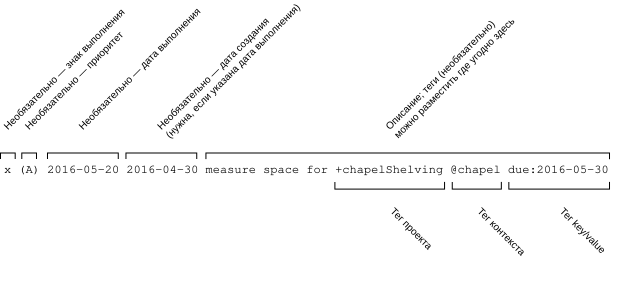

# Формат todo.txt
[](https://gitter.im/todotxt/todotxt)

[English](./README.md) | [Korean (한국어)](./README.ko.md) | [Russian (Русский)](./README.ru.md)

Полное руководство о том, зачем нужен todo.txt и как им пользоваться.

Первое и самое важное правило todo.txt:

> Одна строка в вашем текстовом файле todo.txt — это одна задача.


## Почему именно обычный текст?

Обычный текст не зависит от программ и операционных систем. Его легко искать, переносить и обрабатывать, а сам он занимает мало места. У него нет жёсткой структуры. Он работает, когда чужой веб-сервер недоступен или повреждён ваш файл Outlook .PST. Никакого экспорта и импорта, никаких баз данных, меток, флажков, звёздочек, приоритезации или навязанных _«вставьте название компании»_-правил о том, что с ним можно и нельзя делать.


## Три оси эффективного списка задач

Используя специальную нотацию в todo.txt, вы можете создать список, который можно «нарезать» по трём ключевым осям.


### Приоритет
Ваш список задач должен подсказывать, что самое важное сделать следующим — в рамках проекта, контекста или по списку в целом. Задачам можно по желанию назначить приоритет, который поднимет их в начало списка.


### Проект
Продвинуть большой проект можно, только выполняя небольшие связанные с ним подзадачи. В файле `todo.txt` должны быть перечислены все задачи, относящиеся к конкретному проекту.

Чтобы продвинуть проект вроде «Разбор гаража», мой список задач должен подсказывать следующее логичное действие, приближающее проект к завершению. «Разобрать гараж» — плохой пункт списка задач; а вот «Позвонить в Goodwill, чтобы назначить вывоз вещей» в проекте «Разбор гаража» — хороший.


### Контекст
Автор методики [Getting Things Done](https://en.wikipedia.org/wiki/Getting_Things_Done) Дэвид Аллен предлагает делить списки задач по контекстам — то есть по месту и обстоятельствам, в которых будет выполняться работа. Сообщения, которые нужно отправить, попадают в контекст `@email`; звонки — в `@phone`; домашние проекты — в `@home`.

Например, если у вас есть несколько свободных минут и под рукой телефон, можно открыть список задач `@phone` и сделать один-два звонка.

Всё это возможно внутри `todo.txt`.


## Правила формата `todo.txt`



`todo.txt` — это обычный текстовый файл. Чтобы воспользоваться структурированными метаданными задач — приоритетом, проектами, контекстом, датами создания и выполнения, — существует несколько простых, но гибких правил формата.

У формата `todo.txt` две основные цели:

- Содержимое файла должно быть читаемо человеком без каких-либо инструментов, кроме простого просмотрщика или редактора текста.
- Пользователь может изменять содержимое файла в текстовом редакторе понятным и ожидаемым образом. Например, редактор, умеющий сортировать строки по алфавиту, должен уметь осмысленно сортировать ваш список задач.

Именно поэтому, например, строки начинаются с приоритета и/или дат — чтобы их было легко сортировать по приоритету или времени, — а выполненные пункты помечаются символом `x`, который при алфавитной сортировке попадает в конец списка и при этом выглядит как отмеченный чекбокс.

Вот остальные правила.


## Незавершённые задачи: 3 правила форматирования

Красота todo.txt — в полной свободе структуры; поля, которые можно приписать каждой задаче, ограничены только вашим воображением. Для начала используйте специальную нотацию, чтобы обозначать контекст задачи (например, `@phone`), проект (например, `+GarageSale`) и приоритет (например, `(A)`).

Файл todo.txt может выглядеть так:

```
(A) Поблагодарить маму за тефтели @phone
(B) Договориться с Goodwill о вывозе вещей +GarageSale @phone
Развесить объявления по району +GarageSale
@GroceryStore пироги
```

Поиск и фильтр по контексту `@phone` вернёт:

```
(A) Поблагодарить маму за тефтели @phone
(B) Договориться с Goodwill о вывозе вещей +GarageSale @phone
```

А если оставить только задачи проекта `+GarageSale`, получится:

```
(B) Договориться с Goodwill о вывозе вещей +GarageSale @phone
Развесить объявления по району +GarageSale
```

Для незавершённых задач действуют три правила форматирования.

### Правило 1: Если приоритет задан, он ВСЕГДА стоит в начале.

Приоритет — это заглавная буква от A до Z в круглых скобках, за которой следует пробел.

У этой задачи есть приоритет:

```
(A) Позвонить маме
```

У этих задач приоритета нет:

```
Точно надо позвонить маме (A) @phone @someday
(b) Ответить боссу
(B)->Отправить отчёт TPS
```


### Правило 2: Дата создания задачи может (по желанию) стоять сразу после приоритета и пробела.

Если приоритета нет, дата создания стоит в начале строки. Если дата создания указана, она должна иметь формат `YYYY-MM-DD`.

У этих задач есть дата создания:

```
2011-03-02 Задокументировать формат задач +TodoTxt
(A) 2011-03-02 Позвонить маме
```

У этой задачи даты создания нет:

```
(A) Позвонить маме 2011-03-02
```


### Правило 3: Контексты и проекты могут стоять в любом месте строки _после_ приоритета/даты в начале.

- Перед символом `@`, обозначающим *контекст*, должен стоять один пробел.
- Перед символом `+`, обозначающим *проект*, должен стоять один пробел.
- *Проект* или *контекст* состоит из любых символов, кроме пробельных.
- *Задача* может содержать ноль, один или несколько *проектов* и *контекстов*.

Например, эта задача входит в проекты `+Family` и `+PeaceLoveAndHappiness`, а также в контексты `@iphone` и `@phone`:

```
(A) Позвонить маме +Family +PeaceLoveAndHappiness @iphone @phone
```

В этой задаче нет контекстов:

```
Написать письмо на soandso@example.com
```

В этой задаче нет проектов:

```
Научиться складывать 2+2
```


## Выполненные задачи: 2 правила форматирования

О том, что задача выполнена, говорят две вещи.


### Правило 1: Выполненная задача начинается со строчной буквы x (`x`).

Если задача начинается с `x` (строчная буква, регистр важен), за которой непосредственно следует пробел, она считается выполненной.

Это выполненная задача:

```
x 2011-03-03 Позвонить маме
```

Это невыполненные задачи:

```
xylophone lesson
X 2012-01-01 Дать себе новогодние обещания
(A) x Узнать цены на билеты
```

Строчная буква x используется, чтобы при сортировке стандартными средствами выполненные задачи опускались в конец списка.


### Правило 2: Дата выполнения стоит сразу после x и отделяется от неё пробелом.

Например:

```
x 2011-03-02 2011-03-01 Проверить pull request Тима +TodoTxtTouch @github
```

Если вы добавили к задаче дату создания, то после выполнения она окажется сразу после даты выполнения. Это сделано для того, чтобы выполненные задачи сортировались по дате стандартными средствами. Многие клиенты Todo.txt при выполнении задачи удаляют приоритет. Чтобы сохранить его, используйте описанный ниже формат `key:value` (например, `pri:A`).

Если указаны дата выполнения (обязательная для выполненной задачи) и дата создания (необязательная), можно вычислить, сколько дней потребовалось на выполнение задачи.


## Дополнительные определения формата

Разработчики инструментов могут вводить дополнительные правила форматирования для иных метаданных.

Для определения дополнительных метаданных (например, срока выполнения `due:2010-01-02`) разработчики должны использовать формат `key:value`.

И `key`, и `value` должны состоять из непробельных символов, за исключением двоеточия. `key` и `value` разделяет ровно одно двоеточие.
